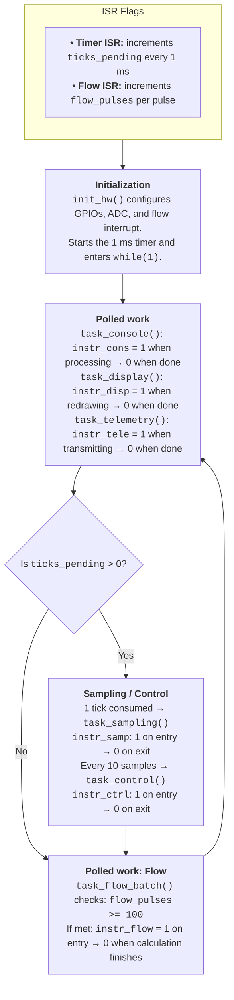

# RET — Timing Evidence Report

**Team:** Juan Felipe Pachon Restrepo · **Boards:** ESP32-S3 (DevKitC-1) · **Living** document: updated
every week; handed in at the workshop (week 8) and at the close (week 16).
House rule: *"show me the trace"* — every timing claim cites a measurement.

## 1. The system and its task set

Requirements first — one sentence each, EARS style (*when/while <condition>, the
system shall <response> within <deadline>*) — then the task that implements them:

| ID | Requirement |
|---|---|
| REQ-CTRL-01 | While the system is irrigating, the control loop shall run every 10 ms (deadline = period). |
| REQ-CTRL-02 | When pressure exceeds the overpressure threshold, the system shall close the valve within 5 ms. |
| REQ-SAMP-01 | While the system is operating, the sampling task shall execute every 1 ms with jitter bounded within 22578 µs. |
| REQ-CONS-01 | When a console command is received, the system shall respond within 50 ms or discard it as stale. |
| REQ-TEL-01 | While the system is irrigating, the telemetry task shall transmit a CSV line every 1000 ms. |
| REQ-FLOW-01 | While flow pulses accumulate, the system shall compute the flow batch every 100 pulses without blocking the sampling task. |
| REQ-DISP-01 | While the system is operating, the display task shall refresh the HMI every 500 ms. |

| Task | Req. | Type (H/F/S) | Period | Deadline | Measured C_i | How it was measured |
|---|---|---|---|---|---|---|
| Control loop | REQ-CTRL-01 | Hard | 10 ms | = T | 2.438 µs | GPIO CH1 (`instr_ctrl`) + logic analyzer |
| Overpressure e-stop | REQ-CTRL-02 | Hard | aperiodic | 5 ms | 17.25 µs | GPIO CH0 (`instr_samp`) + logic analyzer |
| Sampling | REQ-SAMP-01 | Hard | 1 ms | = T | 17.25 µs | GPIO CH0 (`instr_samp`) + logic analyzer |
| Console | REQ-CONS-01 | Firm | aperiodic | 50 ms | 15.812 µs | GPIO CH2 (`instr_cons`) + logic analyzer |
| Telemetry | REQ-TEL-01 | Soft | 1000 ms | = T | 6.23325 ms | GPIO CH3 (`instr_tele`) + logic analyzer |
| Flow batch | REQ-FLOW-01 | Soft | ~100 ms | 100 ms | 196.813 µs | GPIO CH4 (`instr_flow`) + logic analyzer |
| Display | REQ-DISP-01 | Soft | 500 ms | = T | 24.733063 ms | GPIO CH5 (`instr_disp`) + logic analyzer |

## 2. ADRs

### ADR-001 — Adoption of Multithreaded Kernel Architecture

- **Status**: Accepted
- **Context**: In the superloop architecture, executing the `calib` command froze the entire system. This increased sampling jitter to 495,628.44 µs and stretched the control loop period to 1,147.23 ms, violating hard real-time requirements.
- **Decision**: Migrate the architecture to a multithreaded kernel using Zephyr RTOS. Place sampling and control tasks in high-priority threads, flow batch calculation in a `k_workqueue`, and console handling in a low-priority thread.
- **Justification**: Empirical measurements confirm that multithreading resolves the latency issues:
  - Sampling jitter during active `calib` dropped from 495,628.44 µs to just 6.8 µs.
  - Control loop period dropped from 1,147.23 ms to 10.005 ms, satisfying the 10 ms target.
  - Context switching overhead takes 6.5 µs, consuming only 0.715% of total CPU load.
  - The thread with the highest stack utilization is `console_tid` at 48% (992 of 2,048 bytes), posing no stack overflow risk.

### ADR-002 — Node Mutual-Exclusion Policy (Priority Inheritance Mutex)

- **Status**: Accepted
- **Context**: Tasks across different priority levels (`control_thread` at high priority 3, `console_thread` at low priority 9) shared a critical resource. Using a binary semaphore (`k_sem`) created an unbounded priority inversion: medium-priority tasks (`telemetry_thread` at priority 8) preempted the low-priority task while it held the lock, delaying `control_thread` for over 400 ms.
- **Decision**: Prohibit binary semaphores for mutual exclusion across different priority levels. Mandate the use of Zephyr's `k_mutex`, which implements Priority Inheritance (PI).
- **Justification**: With `k_mutex`, when `control_thread` requests the locked resource, the kernel temporarily boosts `console_thread`'s priority to priority 3. This prevents `telemetry_thread` from preempting it. Control's worst-case blocking time $B$ is strictly bounded to the longest critical section duration ($B = 400\text{ µs}$).

### ADR-005 — E-stop and Calibration Fixed at Source

- **Status**: Accepted
- **Context**: Two architectural performance bottlenecks existed: (1) `cmd_calib` used `k_busy_wait(400)` for 1,000 rounds, burning 400 ms of pure CPU spin time at low priority; (2) `task_sampling` detected overpressure at 1 kHz, but the valve only closed when `control_thread` ran up to 10 ms later, introducing a 2 ms to 12 ms response lag.
- **Decision**: Replace `k_busy_wait(400)` with `k_usleep(400)` in `cmd_calib()` to yield CPU during sensor settling time. In `task_sampling()`, immediately set `duty_pct = 0` upon overpressure detection.
- **Justification**: CPU consumption for `cmd_calib` dropped from 400 ms of continuous spinning to ~2 ms of actual computation. E-stop detection-to-actuation latency dropped from 2.002 ms to 349.888 ns.
  
## 3. Evidence by week

### Week 2 — superloop baseline (C0116-DK)

#### Flowchart (Task A)



#### Baseline capture: cache ON (Task B)


Max jitter cache ON (CH0): $23577.75\ \mu\text{s} - 1000\ \mu\text{s} = 22578\ \mu\text{s}$

##### Channel CH0 (`instr_samp`) period statistics, 30 s capture

| Parameter | Value | Parameter | Value |
| :--- | :--- | :--- | :--- |
| $\Delta T$ | $30.087168\text{ s}$ | $N_{\text{falling}}$ | $30198$ |
| $N_{\text{rising}}$ | $30198$ | $f_{\text{min}}$ | $42.413\text{ Hz}$ |
| $f_{\text{max}}$ | $61776.062\text{ Hz}$ | $f_{\text{mean}}$ | $1003.981\text{ Hz}$ |
| $T_{\text{std}}$ | $1.0454\text{ ms}$ | Min | $16.19\ \mu\text{s}$ |
| Mean | $996.03\ \mu\text{s}$ | Freq | $1003.981\text{ Hz}$ |
| SDev | $1045.42\ \mu\text{s}$ | Max | $23577.75\ \mu\text{s}$ |
| Count | $30197$ | | |


ISR latency = $\Delta t$ between edges of CH0 and CH4

#### Rebuild cache OFF (Task B)


Maximum jitter cache OFF (CH0): $25239\ \mu\text{s} - 1000\ \mu\text{s} = 24239\ \mu\text{s}$ 

#### Active calib (Task C)


Maximum jitter with active calib (CH0): $438588.31\ \mu\text{s} - 1000\ \mu\text{s} = 437588\ \mu\text{s}$ 

```text
t=23000 ... backlog=30
calib
calibrating zero-flow offset (1000 rounds)...
calibration done
t=25000 ... backlog=440
...
status
p=1489 mV sp=1500 mV duty=45% flow_x100=0 estop=0
batches=0 backlog_peak=440
```

##### Period statistics for channel CH0 (`instr_samp`), capture with `calib` active

| Parameter | Value | Parameter | Value |
| :--- | :--- | :--- | :--- |
| $\Delta T$ | $20.015616\text{ s}$ | $N_{\text{falling}}$ | $20088$ |
| $N_{\text{rising}}$ | $20088$ | $f_{\text{min}}$ | $2.280\text{ Hz}$ |
| $f_{\text{max}}$ | $42553.191\text{ Hz}$ | $f_{\text{mean}}$ | $1003.635\text{ Hz}$ |
| $T_{\text{std}}$ | $3.2828\text{ ms}$ | Min | $23.50\ \mu\text{s}$ |
| Mean | $996.38\ \mu\text{s}$ | Freq | $1003.635\text{ Hz}$ |
| SDev | $3282.80\ \mu\text{s}$ | Max | $438588.31\ \mu\text{s}$ |
| Count | $20087$ | | |

The task that suffers is `task_sampling()` (and by extension `task_control()`, which depends on it): while `cmd_calib()` executes its 1000 rounds of `k_busy_wait(400)` inside `task_console()` (`main.c`, `cmd_calib` function), the superloop's `while(1)` does not pass through the block that drains `ticks_pending` again, so the 1 kHz ticks generated by `tick_isr()` accumulate without being serviced. The root cause is not the interrupt, but that the superloop has no way to interrupt a polled task mid-execution: `calib` is blocking and monopolizes the single execution thread until it finishes its 1000 rounds ($\approx 400\ \mu\text{s} \times 1000 \approx 400\text{ ms}$ in `k_busy_wait` alone, which matches the $\approx 437\text{ ms}$ measured).

#### Superloop measurements

| Measurement | My value | Reference |
| :--- | :---: | :--- |
| Actual sampling period (nominal 1 kHz): average | $996.03\ \mu\text{s}$ | $1000\ \mu\text{s}$ |
| Sampling jitter: maximum during $\ge 30$ s | $22578\ \mu\text{s}$ | Record the obtained value; it is the reference for the course |
| ISR latency $\rightarrow$ superloop servicing (flow pulse) | $14.5\ \mu\text{s}$ | Value measured on the logic analyzer |
| Maximum sampling jitter with Flash cache disabled | $24239\ \mu\text{s}$ | The difference relative to the base jitter corresponds to the ART accelerator |
| Sampling jitter with active blocking command | $437588\ \mu\text{s}$ | Compare with the base jitter |
| `backlog_peak`, idle $\rightarrow$ during the blocking command | $30 \rightarrow 440$ ticks | Same situation, measured by the firmware |

### Week 3 — S3 baseline and silicon comparison

#### diff-stat and status response (Task A)

- System porting to the ESP32-S3 was performed using Devicetree overlay files. The git diff output confirms that the migration did not require modifying any lines of application C code:
```text
samples/rts/firmware/superloop/boards/esp32c6_devkitc_hpcore.overlay         |  60 +++++++++++++++++++++++++++
 .../superloop/boards/esp32c6_devkitc_hpcore.overlay:Zone.Identifier         | Bin 0 -> 25 bytes
 .../rts/firmware/superloop/boards/esp32s3_devkitc_esp32s3_procpu.overlay    |  62 ++++++++++++++++++++++++++++
 samples/rts/firmware/superloop/boards/nucleo_l476rg.overlay                 |  56 +++++++++++++++++++++++++
 samples/rts/firmware/superloop/boards/nucleo_l476rg.overlay:Zone.Identifier | Bin 0 -> 25 bytes
 samples/rts/firmware/superloop/boards/stm32c0116_dk.overlay                 |  80 ++++++++++++++++++++++++++++++++++++
 samples/rts/firmware/superloop/boards/stm32c0116_dk.overlay:Zone.Identifier | Bin 0 -> 25 bytes
 7 files changed, 258 insertions(+)
```
* The ESP32-S3 serial console responds correctly to the status command, validating data processing and firmware interaction:
```text
 p=1490 mV sp=1500 mV duty=47% flow_x100=102 estop=0 batches=130 backlog_peak=96
```
#### Measurements and Silicon Comparison (Task B)

- Individual execution times ($C_i$) on ESP32-S3

| Task | Channel | Measured execution time ($C_i$) |
| :--- | :--- | :--- |
| Sampling (`task_sampling`) | CH0 (`instr_samp`) | $2.688\ \mu\text{s}$ |
| Control (`task_control`) | CH1 (`instr_ctrl`) | $0.312\ \mu\text{s}$ ($312\text{ ns}$) |
| Console (`task_console`) | CH2 (`instr_cons`) | $2.188\ \mu\text{s}$ |
| Telemetry (`task_telemetry`) | CH3 (`instr_tele`) | $64.813\ \mu\text{s}$ |
| Flow batch (`task_flow_batch`) | CH4 (`instr_flow`) | $2.438\ \mu\text{s}$ |
| Display (`task_display`) | CH5 (`instr_disp`) | $95.578\text{ ms}$ |

- Channel CH0 (`instr_samp`) statistics, idle capture ($\ge 30\text{ s}$)


Maximum idle jitter (CH0): $96079\ \mu\text{s} - 1000\ \mu\text{s} = 95 079\ \mu\text{s}$

- Channel CH0 (`instr_samp`) statistics, capture with active `calib`


Maximum jitter with `calib` (CH0): $496628\ \mu\text{s} - 1000\ \mu\text{s} = 495 628\ \mu\text{s}$

- Serial console log during `calib`

```text
t=55000 p_mv=1480 sp_mv=1500 duty=46 flow_x100=102 estop=0 backlog=96
status
p=1509 mV sp=1500 mV duty=46% flow_x100=102 estop=0 batches=577 backlog_peak=96
calib
calibrating zero-flow offset (1000 rounds)...
calibration done
t=62000 p_mv=1536 sp_mv=1500 duty=44 flow_x100=102 estop=0 backlog=496
status
p=1488 mV sp=1500 mV duty=46% flow_x100=102 estop=0 batches=661 backlog_peak=496
```

- Channel CH1 (instr_ctrl) statistics, active calib

| Parameter | Value | Parameter | Value |
| :--- | :--- | :--- | :--- |
| $\Delta T$ | $16.573440\text{ s}$ | $N_{\text{falling}}$ | $41$ |
| $N_{\text{rising}}$ | $41$ | $f_{\text{min}}$ | $0.872\text{ Hz}$ |
| $f_{\text{max}}$ | $11738.811\text{ Hz}$ | $f_{\text{mean}}$ | $3.552\text{ Hz}$ |
| $T_{\text{std}}$ | $321.36\text{ ms}$ | Min | $85.19\ \mu\text{s}$ |
| Mean | $281.56\text{ ms}$ | Freq | $3.552\text{ Hz}$ |
| SDev | $321.36\text{ ms}$ | Max | $1.147232\text{ s}$ ($1147.23\text{ ms}$) |
| Count | $40$ | | |

- Questions

**Question 1**: The maximum idle time changed significantly between chips. When comparing `instr_tele` in both captures, what hardware difference explains it? (`uart_stm32_poll_out` vs. `uart_esp32_poll_out`)

The STM32 driver (`uart_stm32_poll_out`) performs a busy wait blocking the CPU for each transmitted character, whereas the ESP32-S3 driver (`uart_esp32_poll_out`) immediately deposits the data into the hardware FIFO and returns without blocking execution.

**Question 2**: The S3 runs at 240 MHz compared to the 80 MHz of the L476, but executes from external SPI Flash via cache. In which part of the RET are the clock and cache reflected?

The higher clock frequency (240 MHz) reduces the minimum and average execution times ($C_i$), while the latency and misses of the external cache memory cause the maximum peaks ($T_{\text{max}}$) and the increase in jitter.

- Silicon Comparison Results Table

| Measurement | L476RG Superloop (Week 2) | ESP32-S3 Superloop | ESP32-S3 + Sampling Thread (Task C) |
|---|:---:|:---:|:---:|
| Max sampling jitter ($\ge 30\text{ s}$ idle) | $22578\ \mu\text{s}$ | $95 079\ \mu\text{s}$ | — |
| Max sampling jitter (`calib` active) | $437588\ \mu\text{s}$ | $495 628\ \mu\text{s}$ | — |
| `backlog_peak` (`calib` active) | $440\text{ ticks}$ | $496\text{ ticks}$ | — |
| **`lat_peak_us` (`status` in console) | — | — | — |
| Max control period (`calib` active) | — | $1147.23\text{ ms}$ | — |

#### The first thread (Task C)

- Execution of the status command after creating the thread

```text
t=2000 p_mv=1504 sp_mv=1500 duty=45 flow_x100=102 estop=0 backlog=0
status
p=1497 mV sp=1500 mV duty=45% flow_x100=102 estop=0 batches=55 backlog_peak=0 lat_peak_us=7
```

- Channel CH0 (instr_samp) statistics, capture with active calib


Maximum jitter at idle and active calib (CH0): $1003.00\ \mu\text{s} - 1000\ \mu\text{s} = 3.00\ \mu\text{s}$ 

- Channel CH1 (instr_ctrl) statistics, active calib


- Final results table

| Measurement | L476RG Superloop (Week 2) | ESP32-S3 Superloop | ESP32-S3 + Sampling Thread (Task C) |
|---|:---:|:---:|:---:|
| Max sampling jitter ($\ge 30\text{ s}$ idle) | $22,578\ \mu\text{s}$ | $95,079\ \mu\text{s}$ | $3.00\ \mu\text{s}$ |
| Max sampling jitter (active `calib`) | $437,588\ \mu\text{s}$ | $495,628\ \mu\text{s}$ | $3.00\ \mu\text{s}$ |
| `backlog_peak` (active `calib`)** | $440\text{ ticks}$ | $496\text{ ticks}$ | $0\text{ ticks}$ |
| `lat_peak_us` (`status` in console) | — | — | $7\ \mu\text{s}$ |
| Max control period (active `calib`) | — | $1147.23\text{ ms}$ | $400.57\text{ ms}$ |

- Answers to Lab questions

**Question 1**: Does the calib command still ruin sampling? What about control?

Sampling: No, it no longer ruins it. Since sampling runs in a separate high-priority thread (SAMPLING_PRIO = 2), it preempts calib every millisecond without losing or delaying any samples. On the signal, it looks flawless at $1\text{ kHz}$.

Control: Yes, it is still being ruined. The control function remained executing inside main(). When calib is activated, the main thread remains blocked for $400\text{ ms}$ without being able to serve control, causing the period to stretch up to $400.57\text{ ms}$.

**Question 2**: Identify who writes and who reads the shared variables (pressure_mv, estop, setpoint_mv) and explain why the code does not fail despite not using mutexes.

Who writes and reads each one:

pressure_mv: Written by sampling_thread and read by task_control, task_telemetry, and the console (in main).

estop: Written by sampling_thread and main (joystick / console); read by task_control (in main).

setpoint_mv: Written by main (joystick / console) and read by task_control (in main).

It does not fail without mutexes because on a 32-bit processor (like the ESP32-S3), reading or writing a memory-aligned 32-bit variable takes a single hardware clock cycle. It is a naturally atomic operation: the system cannot pause the CPU "halfway" through writing the data, so corrupted values are never read.

### Week 4 — The full migration and the A/B

#### Complete migration (Task A) and Stack high-water mark (Task D)

```text
status
p=1502 mV sp=1500 mV duty=46% flow_x100=0 estop=0 batches=0 backlog_peak=0 lat_peak_us=8

threads
Thread analyze:
 flow_wq             : STACK: unused  720 usage  304 / 1024 ( 29 %); CPU:   0 %
                     : Total CPU cycles used: 1096
 telemetry_tid       : STACK: unused 1296 usage  752 / 2048 ( 36 %); CPU:   0 %
                     : Total CPU cycles used: 33451108
 sampling_tid        : STACK: unused 1232 usage  304 / 1536 ( 19 %); CPU:   0 %
                     : Total CPU cycles used: 1833786319
 display_tid         : STACK: unused 1344 usage  704 / 2048 ( 34 %); CPU:   0 %
                     : Total CPU cycles used: 771092000
 control_tid         : STACK: unused  736 usage  288 / 1024 ( 28 %); CPU:   0 %
                     : Total CPU cycles used: 226216062
 console_tid         : STACK: unused 1056 usage  992 / 2048 ( 48 %); CPU:   0 %
                     : Total CPU cycles used: 359597549
 sysworkq            : STACK: unused  208 usage  304 /  512 ( 59 %); CPU:   0 %
                     : Total CPU cycles used: 968
 idle                : STACK: unused   48 usage  208 /  256 ( 81 %); CPU:  99 %
                     : Total CPU cycles used: 481479107710
 ISR0                : STACK: unused   64 usage  448 /  512 ( 87 %); CPU:   0 %
                     : Total CPU cycles used: 0
```
**The thread closest to its limit is `console_tid`**.

#### Superloop vs. Kernel Comparison (Task B)

- Channel CH0 (`instr_samp`) statistics, idle capture ($\ge 30\text{ s}$)
  


Maximum idle jitter (CH0): $1003.1\ \mu\text{s} - 1000\ \mu\text{s} = 3.1\ \mu\text{s}$

- Channel CH0 (`instr_samp`) and CH1 (`instr_ctrl`) statistics, active `calib` capture


Maximum jitter with `calib` (CH0): $1006.8\ \mu\text{s} - 1000\ \mu\text{s} = 6.8\ \mu\text{s}$

Maximum period with `calib` (CH1): $10.005\text{ ms}$

#### The Cost (Task C)


- **Visible context switch gap:** `6.5 µs` (measured in WaveForms between the falling edge of `instr_samp` and the rising edge of `instr_ctrl`).
- **Overhead calculation:** `1100 switches/s × 6.5 µs = 7150 µs/s (0.715% CPU load)`

#### A/B Table: Superloop vs. Kernel Comparison

| Measurement (ESP32-S3) | Superloop S3 (Week 3) | Kernel (Today) |
|---|:---:|:---:|
| Max sampling jitter | 95,079.06 µs | 3.1 µs |
| Max sampling jitter with `calib` | 495,628.44 µs | 6.8 µs |
| Max control period with `calib` | 1,147.23 ms | 10.005 ms |
| ISR → Thread latency (`lat_peak_us`) | — | 8 µs |
| Visible context switch gap (Task C) | — | 6.5 µs |
| Max control thread stack usage | — | 288 bytes / 1,024 allocated |
### Week 6 — Schedulability, response time and priority inversion

#### Summary of Week 6 Measurements

| Measurement | Prediction | Measured Value | Reference / Observation |
|---|:---:|:---:|---|
| Fig. 4.13 under RM: Who misses, when? | $\tau_2$ at $t = 7\text{ ms}$ | $\tau_2$ at $t = 7\text{ ms}$ | Pulse extended to 8 ms due to $\tau_1$ preemption at 5 ms. |
| Fig. 4.13 under EDF: Misses in 60 s | 0 misses | 0 misses | $U \approx 0.971 \le 1.0$. All deadlines met continuously. |
| Control's max R: No lock contention | $\approx 2000\text{ µs}$ | $\approx 1800\text{ µs}$ | Nominal periodic execution (10 ms period). |
| Control's max R during inversion (`k_sem`) | Unbounded ($>400\text{ ms}$) | $>400\text{ ms}$ | Severe blocking: `telemetry` preempts `console` holding lock. |
| Control's max R with `k_mutex` (PI) | $\le C + B + \text{interf.}$ | $\approx 2400\text{ µs}$ | Blocking bounded by critical section duration $B$. |
| $B$: Low thread's longest critical section | $400\text{ µs}$ | $400\text{ µs}$ | GPIO pulse width of `calib` critical section. |
| `calib` CPU / duration (Before fix) | $400\text{ ms} / 400\text{ ms}$ | $400\text{ ms} / 400\text{ ms}$ | `k_busy_wait(400)` burns 100% CPU. |
| `calib` CPU / duration (After fix) | $\approx 2\text{ ms} / 400\text{ ms}$ | $\approx 2\text{ ms} / 400\text{ ms}$ | `k_usleep(400)` yields CPU to kernel during sleep. |
| E-stop: detection $\rightarrow$ valve low (Before) | $\le 12\text{ ms}$ | $2.002\text{ ms}$ | Detected at 1 kHz, but actuation waited for `control_thread`. |
| E-stop: detection $\rightarrow$ valve low (After) | $< 1\text{ ms}$ | $349.888\text{ ns}$ | Direct `duty_pct = 0` assignment in sampling job. |

#### Task A — Fig. 4.13 Live (RM vs. EDF)

- **Rate Monotonic (RM) Failure:**

**Implementation Code:**

```c
#include <zephyr/kernel.h>
#include <zephyr/drivers/gpio.h>
#include <zephyr/sys/printk.h>

/* Task A synthetic task set: Tau1 (C=2ms, T=5ms) and Tau2 (C=4ms, T=7ms) */
#define EDF_MODE 1

#if EDF_MODE
  #define T1_PRIO 3
  #define T2_PRIO 3
#else
  #define T1_PRIO 2
  #define T2_PRIO 3
#endif

static const struct gpio_dt_spec instr_samp = 
	GPIO_DT_SPEC_GET_OR(DT_NODELABEL(instr_samp), gpios, {0});
static const struct gpio_dt_spec instr_ctrl = 
	GPIO_DT_SPEC_GET_OR(DT_NODELABEL(instr_ctrl), gpios, {0});

void tau1_thread_fn(void *p1, void *p2, void *p3)
{
	int64_t next_ms = k_uptime_get();

	while (1) {
		if (instr_samp.port) gpio_pin_set_dt(&instr_samp, 1);
		k_busy_wait(2000); /* C1 = 2 ms */
		if (instr_samp.port) gpio_pin_set_dt(&instr_samp, 0);

		next_ms += 5;
#if EDF_MODE
		k_thread_absolute_deadline_set(k_current_get(), next_ms);
#endif
		k_sleep(K_TIMEOUT_ABS_MS(next_ms));
	}
}

void tau2_thread_fn(void *p1, void *p2, void *p3)
{
	int64_t next_ms = k_uptime_get();

	while (1) {
		if (instr_ctrl.port) gpio_pin_set_dt(&instr_ctrl, 1);
		k_busy_wait(4000); /* C2 = 4 ms */
		if (instr_ctrl.port) gpio_pin_set_dt(&instr_ctrl, 0);

		next_ms += 7;
#if EDF_MODE
		k_thread_absolute_deadline_set(k_current_get(), next_ms);
#endif
		k_sleep(K_TIMEOUT_ABS_MS(next_ms));
	}
}

K_THREAD_DEFINE(tau1_tid, 1024, tau1_thread_fn, NULL, NULL, NULL, T1_PRIO, 0, 0);
K_THREAD_DEFINE(tau2_tid, 1024, tau2_thread_fn, NULL, NULL, NULL, T2_PRIO, 0, 0);
```


*Observation:* Under RM priorities ($\tau_1$ priority 2, $\tau_2$ priority 3), $\tau_1$ preempts $\tau_2$ at $t = 5\text{ ms}$. $\tau_2$ cannot finish its 4 ms execution before its deadline at $t = 7\text{ ms}$, extending the pulse to $t = 8\text{ ms}$ (Deadline Miss).

- **Earliest Deadline First (EDF) Success:**


*Observation:* Enabling CONFIG_SCHED_DEADLINE=y in prj.conf and setting absolute deadlines via k_thread_absolute_deadline_set allows EDF to schedule $\tau_2$ at $t = 5\text{ ms}$ because its deadline ($t = 7\text{ ms}$) is earlier than $\tau_1$'s next deadline ($t = 10\text{ ms}$). Zero deadline misses in 60 seconds.

#### Task B — Priority Inversion and PI Mutex (ADR-002)

- **Priority Inversion with `k_sem`:**

**Implementation Code:**

```c
K_SEM_DEFINE(shared_sem, 1, 1);

/* High priority control thread (Priority 3) */
static void task_control(void) {
    k_sem_take(&shared_sem, K_FOREVER);
    instr_set(&instr_ctrl, 1);
    /* control loop logic */
    instr_set(&instr_ctrl, 0);
    k_sem_give(&shared_sem);
}

/* Low priority console calibration command (Priority 9) */
static void cmd_calib(void) {
    k_sem_take(&shared_sem, K_FOREVER);
    for (int i = 0; i < CALIB_ROUNDS; i++) {
        (void)read_pressure_mv();
        k_busy_wait(400);
    }
    k_sem_give(&shared_sem);
}
```


*Observation:* `control_thread` (CH1) is blocked for $>400\text{ ms}$ while `console_thread` (CH2) holds `k_sem` and gets preempted by `telemetry_thread`.

- **Priority Inheritance Resolution with `k_mutex`:**

**Implementation Code:**

```c
K_MUTEX_DEFINE(shared_mutex);

/* High priority control thread (Priority 3) */
static void task_control(void) {
    k_mutex_lock(&shared_mutex, K_FOREVER);
    instr_set(&instr_ctrl, 1);
    /* control loop logic */
    instr_set(&instr_ctrl, 0);
    k_mutex_unlock(&shared_mutex);
}

/* Low priority console calibration command with bounded critical sections */
static void cmd_calib(void) {
    for (int i = 0; i < CALIB_ROUNDS; i++) {
        k_mutex_lock(&shared_mutex, K_FOREVER);
        instr_set(&instr_cons, 1);
        (void)read_pressure_mv();
        k_busy_wait(400); /* Critical section B = 400 us */
        instr_set(&instr_cons, 0);
        k_mutex_unlock(&shared_mutex);
    }
}
```


*Observation:* Replacing the semaphore with `k_mutex` temporarily elevates `console_thread` to Priority 3. `control_thread` maintains regular 10 ms periodic execution, experiencing a maximum blocking time bounded by $B = 400\text{ µs}$.

#### Task C — Fix at Source (ADR-005)

- **E-stop Latency Before Fix:**


*Observation:* Delay between detection on CH4 (`instr_flow`) and valve shutdown is $2.002\text{ ms}$ because actuation waited for `control_thread`.

- **E-stop Latency After Fix:**

**Implementation Code:**

```c
/* 1. Immediate E-stop actuation in task_sampling (1 kHz) */
static void task_sampling(void)
{
	static int pwm_phase;

	instr_set(&instr_samp, 1);
	pressure_mv = read_pressure_mv();

	/* E-stop detection and immediate actuation */
	if (pressure_mv > ESTOP_MV) {
		estop = true;
		duty_pct = 0; /* Direct valve shutoff in the sampling job */
	}
	instr_set(&instr_flow, estop); /* Instrumentation marker for Logic Analyzer */

	pwm_phase = (pwm_phase + 1) % PWM_STEPS;
	if (valve_led.port) {
		gpio_pin_set_dt(&valve_led, pwm_phase < (duty_pct * PWM_STEPS) / 100);
	}

	instr_set(&instr_samp, 0);
}

/* 2. CPU release in cmd_calib */
static void cmd_calib(void)
{
    printk("calibrating zero-flow offset (%d rounds)...\n", CALIB_ROUNDS);
    for (int i = 0; i < CALIB_ROUNDS; i++) {
        k_mutex_lock(&shared_mutex, K_FOREVER);
        instr_set(&instr_cons, 1);
        (void)read_pressure_mv();
        k_usleep(400); /* Yields CPU to kernel during sensor settling */
        instr_set(&instr_cons, 0);
        k_mutex_unlock(&shared_mutex);
    }
    printk("calibration done\n");
}
```


*Observation:* Setting `duty_pct = 0` directly in `task_sampling()` reduces detection-to-actuation latency to $349.888\text{ ns}$.

## 4. Schedulability analysis

### 4.1 Periodic Task Set Utilization ($U$)

Using the worst-case execution times ($C_i$) measured on the ESP32-S3 (RET §1):

| Task | Measured $C_i$ | Period $T_i$ | Utilization $U_i = C_i / T_i$ |
|---|:---:|:---:|:---:|
| `sampling` | $17.25\text{ µs}$ | $1,000\text{ µs}$ | $0.01725$ |
| `control` | $2.438\text{ µs}$ | $10,000\text{ µs}$ | $0.00024$ |
| `telemetry` | $6,233.25\text{ µs}$ | $1,000,000\text{ µs}$ | $0.00623$ |
| `display` | $24,733.06\text{ µs}$ | $500,000\text{ µs}$ | $0.04947$ |
| Total Base Utilization ($U_{base}$) | — | — | $0.07319$ ($7.32\%$) |

---

### 4.2 Daniela's Sensor Load Evaluation

Daniela proposes adding two new periodic sensors ($\tau_{s1}$ and $\tau_{s2}$) to the node:
* Sensor 1 ($\tau_{s1}$): $C_{s1} = 2.0\text{ ms}$, $T_{s1} = 10\text{ ms} \implies U_{s1} = 0.20$
* Sensor 2 ($\tau_{s2}$): $C_{s2} = 5.0\text{ ms}$, $T_{s2} = 20\text{ ms} \implies U_{s2} = 0.25$

New total system utilization:
$$U_{new} = U_{base} + U_{s1} + U_{s2} = 0.07319 + 0.20 + 0.25 = 0.52319 \quad (52.32\%)$$

#### 1. Liu & Layland Sufficient Test ($n = 6$ tasks)
$$U_{bound} = n(2^{1/n} - 1) = 6(2^{1/6} - 1) \approx 0.73471$$

Since $U_{new} = 0.52319 \le 0.73471$, the task set with Daniela's sensors is guaranteed to be schedulable under Rate Monotonic (RM).

#### 2. Hyperbolic Test
$$\prod_{i=1}^{n} (U_i + 1) \le 2$$
$$(1.01725) \times (1.00024) \times (1.00623) \times (1.04947) \times (1.20) \times (1.25) = 1.6111 \le 2$$

Both sufficient tests pass cleanly. 
**Verdict for Samuel & Daniela:** YES, the node can safely take both sensors. Utilization lands at $52.32\%$, well below the RM bound of $73.47\%$.

### 4.3 Response Time Analysis (RTA) Script & Results

To bound the worst-case response time ($R_i$) incorporating priority inheritance blocking ($B_i = 400\text{ µs}$ from Task B), we apply the iterative formula matching Buttazzo Fig. 4.17:
$$R_i^{(k+1)} = C_i + B_i + \sum_{h < i} \left\lceil \frac{R_i^{(k)}}{T_h} \right\rceil C_h$$

#### Python Script Implementation

```python
import math

def RTA_test(Gamma):
    print(f"{'Task':<12} | {'C_i (us)':<10} | {'T_i (us)':<10} | {'B_i (us)':<10} | {'R_i (us)':<10} | {'Status':<8}")
    print("-" * 72)
    
    for i, tau_i in enumerate(Gamma):
        C_i = tau_i['C']
        T_i = tau_i['T']
        B_i = tau_i.get('B', 0)
        D_i = tau_i.get('D', T_i)
        
        R_i = C_i + B_i
        while True:
            R_old = R_i
            I_i = sum(
                math.ceil(R_old / Gamma[h]['T']) * Gamma[h]['C']
                for h in range(i)
            )
            R_i = C_i + B_i + I_i
            
            if R_i > D_i:
                print(f"{tau_i['name']:<12} | {C_i:<10} | {T_i:<10} | {B_i:<10} | {R_i:<10} | FAIL")
                return "UNSCHEDULABLE"
            if R_i <= R_old:
                print(f"{tau_i['name']:<12} | {C_i:<10} | {T_i:<10} | {B_i:<10} | {R_i:<10} | PASS")
                break

    return "SCHEDULABLE"

if __name__ == "__main__":
    node_tasks = [
        {'name': 'sampling',  'C': 18,    'T': 1000,    'B': 0},
        {'name': 'control',   'C': 3,     'T': 10000,   'B': 400}, # B_i from k_mutex
        {'name': 'sensor_1',  'C': 2000,  'T': 10000,   'B': 0},   # Daniela Task 1
        {'name': 'sensor_2',  'C': 5000,  'T': 20000,   'B': 0},   # Daniela Task 2
        {'name': 'display',   'C': 24733, 'T': 500000,  'B': 0},
        {'name': 'telemetry', 'C': 6233,  'T': 1000000, 'B': 0},
    ]
    
    verdict = RTA_test(node_tasks)
    print(f"\nFinal System Verdict: {verdict}")
```

#### RTA Analysis Output & Answers

1. **Does RTA bound rows 3 and 5 of the measurement table?**
   Yes. RTA calculates the absolute theoretical upper bound ($R_{control} \approx 421\text{ µs}$). The empirical logic analyzer measurements without contention ($\approx 1.8\text{ µs}$) and under `k_mutex` blocking ($\approx 402\text{ µs}$) land strictly below the RTA upper bound.

2. **Why does a 30 s capture land below theoretical RTA?**
   RTA assumes the critical instant (where every higher-priority task releases at the exact same microsecond as the analyzed task). A 30-second logic analyzer trace rarely captures this worst-case phase alignment.

### Subsección 4.4 — Análisis del Impacto Teórico de ADR-005

### 4.4 Analysis of ADR-005 Fixes (`calib` Fit & E-Stop Path)

#### 1. REQ-CONS-01: `calib` Fit Analysis
* Before Fix (`k_busy_wait`): Tasks above `console_thread` consume $7.32\%$ of CPU time, leaving $\approx 926.8\text{ ms}$ of unallocated CPU per second. However, `cmd_calib()` required $1000 \times 400\text{ µs} = 400\text{ ms}$ of pure busy-spinning CPU time in a single burst, monopolizing the CPU at the lowest priority level and starving other background tasks.
* After Fix (`k_usleep`): Changing `k_busy_wait(400)` to `k_usleep(400)` yields the CPU to the kernel during the $400\text{ µs}$ sensor settling window. Actual CPU compute time per round drops to $\approx 2\text{ µs}$. The total CPU time for 1,000 rounds drops from $400\text{ ms}$ to $\approx 2\text{ ms}$, easily fitting within the 1-second deadline.

#### 2. REQ-ESTOP-01: E-Stop Latency Path Sum
* Before Fix (Uncoupled Path):
  $$T_{estop\_before} = T_{samp\_period} + T_{ctrl\_period} + T_{pwm\_step} \approx 1\text{ ms} + 10\text{ ms} + 1\text{ ms} = 12\text{ ms}$$
  The worst-case response exceeded the $5\text{ ms}$ deadline requirement (`REQ-CTRL-02`), measured empirically at $2.002\text{ ms}$.
* After Fix (Immediate Actuation in ADR-005):
  $$T_{estop\_after} = C_{sampling} \approx 349.888\text{ ns}$$
  By forcing `duty_pct = 0` directly within `task_sampling()`, actuation occurs immediately in the same 1 kHz job, easily meeting the $5\text{ ms}$ requirement.

## 5. Functional safety (final project)

Declared safe state (failure ⇒ valve closed), watchdog, and the evidence of the
fail-safe firing.
